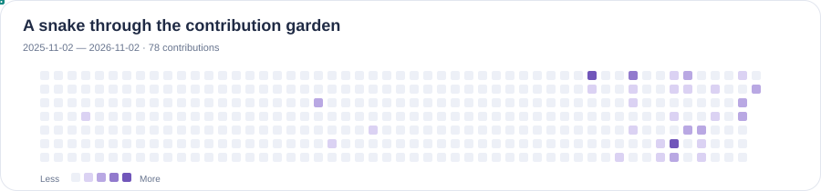
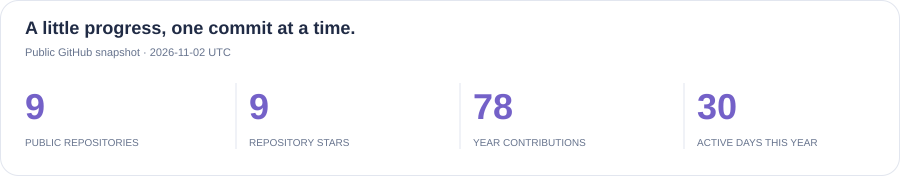
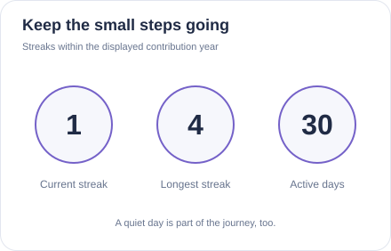
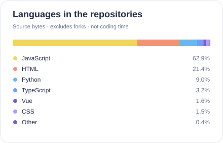
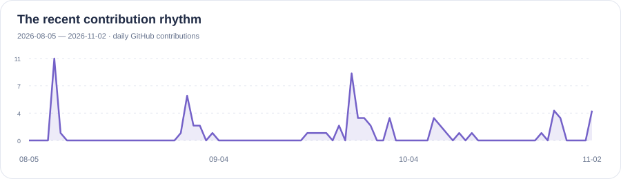
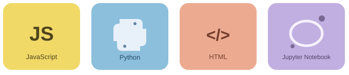
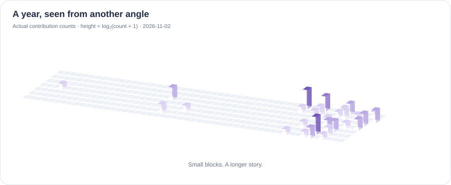
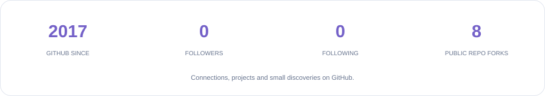

<!-- Generated by scripts/update_profile.py. Edit this template, then regenerate. -->

  
    
  
   
  
    
  
  &nbsp;
  
  &nbsp;
  

 

<picture>
  <source media="(prefers-color-scheme: dark)" srcset="./assets/generated/snake-dark.svg" />
  <source media="(prefers-color-scheme: light)" srcset="./assets/generated/snake-light.svg" />
  
</picture>

 

<h2>🙋 Hello · 很高兴在这里遇见你</h2>

<table width="100%">
<tr><td>

<h3>👋 About me</h3>

你好，我是 <strong>phdsx</strong>。

这个主页收录了我的公开仓库、近期更新，以及 GitHub 上的点滴记录。

在我的公开仓库里，可以找到 JavaScript、Python、HTML 和 Jupyter Notebook 相关内容。

欢迎逛逛下面的项目，也欢迎通过仓库里的 Issue 交流具体问题。

<a href="https://github.com/phdsx?tab=repositories">浏览公开仓库 →</a>

</td></tr>
<tr><td>
<h3>🗂️ A few things you will find here</h3>

🌐 网页仓库 &nbsp; · &nbsp; 🧩 Autojs 练习脚本 &nbsp; · &nbsp; 🐍 Python 代码 &nbsp; · &nbsp; 📒 Notebook

仓库中的具体功能、使用方式和来源说明，请以各项目的 README 与代码为准。

</td></tr>
<tr><td>
<h3>📌 Recent repository updates</h3>

按公开仓库的最近推送时间排序。

<ul>
<li><strong>2026-10-27</strong> · <a href="https://github.com/phdsx/phdsx.github.io">phdsx.github.io</a></li>
<li><strong>2026-04-23</strong> · <a href="https://github.com/phdsx/TrendRadar">TrendRadar</a></li>
<li><strong>2025-11-25</strong> · <a href="https://github.com/phdsx/tool.github.io">tool.github.io</a></li>
<li><strong>2025-07-08</strong> · <a href="https://github.com/phdsx/pic_cut.github.io">pic_cut.github.io</a></li>
<li><strong>2023-03-27</strong> · <a href="https://github.com/phdsx/dinnerninja.github.io">dinnerninja.github.io</a></li>
</ul>
</td></tr>
</table>

 

<h2>🧩 Repositories · 从这里开始探索</h2>

下面是我账号下的公开仓库。点击名称可查看项目详情。

<table>
<tr><td width="50%" valign="top"><h3><a href="https://github.com/phdsx/Autojs-practice">Autojs-practice</a></h3>
Autojs练习脚本，不保证可用，不保证完整

<code>JavaScript</code> · ⭐ 6
</td><td width="50%" valign="top"><h3><a href="https://github.com/phdsx/Python-public">Python-public</a></h3>
查看仓库中的代码与说明。

<code>Python</code> · ⭐ 3
</td></tr>
<tr><td width="50%" valign="top"><h3><a href="https://github.com/phdsx/Pytorch-NLP">Pytorch-NLP</a></h3>
查看仓库中的代码与说明。

<code>Jupyter Notebook</code> · ⭐ 0
</td><td width="50%" valign="top"><h3><a href="https://github.com/phdsx/phdsx.github.io">phdsx.github.io</a></h3>
查看仓库中的代码与说明。

<code>JavaScript</code> · ⭐ 0
</td></tr>
<tr><td width="50%" valign="top"><h3><a href="https://github.com/phdsx/tool.github.io">tool.github.io</a></h3>
查看仓库中的代码与说明。

<code>HTML</code> · ⭐ 0
</td><td width="50%" valign="top"><h3><a href="https://github.com/phdsx/pic_cut.github.io">pic_cut.github.io</a></h3>
查看仓库中的代码与说明。

<code>HTML</code> · ⭐ 0
</td></tr>
<tr><td width="50%" valign="top"><h3><a href="https://github.com/phdsx/dinnerninja.github.io">dinnerninja.github.io</a></h3>
DinnerNinja

<code>JavaScript</code> · ⭐ 0
</td><td width="50%" valign="top"><h3><a href="https://github.com/phdsx/TrendRadar">TrendRadar</a></h3>
查看仓库中的代码与说明。

<code>Python</code> · ⭐ 0
</td></tr>
</table>

<a href="https://github.com/phdsx?tab=repositories">更多仓库与更新 →</a>

 

<h2>📊 GitHub overview · 每一步都有记录</h2>

  
   
<picture>
  <source media="(prefers-color-scheme: dark)" srcset="./assets/generated/overview-dark.svg" />
  <source media="(prefers-color-scheme: light)" srcset="./assets/generated/overview-light.svg" />
  
</picture>

 

<table width="100%">
<tr>
<td width="50%" valign="top">
<picture>
  <source media="(prefers-color-scheme: dark)" srcset="./assets/generated/streak-dark.svg" />
  <source media="(prefers-color-scheme: light)" srcset="./assets/generated/streak-light.svg" />
  
</picture>
</td>
<td width="50%" valign="top">
<picture>
  <source media="(prefers-color-scheme: dark)" srcset="./assets/generated/languages-dark.svg" />
  <source media="(prefers-color-scheme: light)" srcset="./assets/generated/languages-light.svg" />
  
</picture>
</td>
</tr>
</table>

语言占比按非 fork 公开仓库的语言字节数汇总，不代表熟练程度或编程时长。连续活跃天数仅在下方贡献日历范围内计算。

 

<h2>📈 Activity · 最近的贡献节奏</h2>

<picture>
  <source media="(prefers-color-scheme: dark)" srcset="./assets/generated/activity-dark.svg" />
  <source media="(prefers-color-scheme: light)" srcset="./assets/generated/activity-light.svg" />
  
</picture>

 

<h2>🛠️ Languages · 代码里的几种语言</h2>

以下语言出现在我的公开仓库中。

  
    
  

<h2>🌌 Contribution landscape · 把一年变成一片风景</h2>

<picture>
  <source media="(prefers-color-scheme: dark)" srcset="./assets/generated/contributions-3d-dark.svg" />
  <source media="(prefers-color-scheme: light)" srcset="./assets/generated/contributions-3d-light.svg" />
  
</picture>

来自 phdsx 的真实贡献日历 · 2025-11-02 — 2026-11-02

 

<h2>🤝 Around GitHub · 项目之外的连接</h2>

<picture>
  <source media="(prefers-color-scheme: dark)" srcset="./assets/generated/community-dark.svg" />
  <source media="(prefers-color-scheme: light)" srcset="./assets/generated/community-light.svg" />
  
</picture>
    
  
<em>让小小的想法，在一次次提交中慢慢成形。</em>

   
  
  
公开数据快照：2026-11-02 UTC

